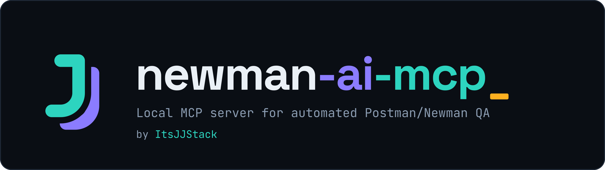

<p align="center">
  
</p>
<p align="center">
  <a href="LICENSE"></a>
  <a href="https://nodejs.org"></a>
  <a href="https://modelcontextprotocol.io"></a>
</p>

Local MCP server over stdio for automated Postman/Newman QA. It exposes nine tools: six deterministic tools and three AI-powered tools. AI can run locally with Qwen3.5-2B through `node-llama-cpp`, or through an OpenAI-compatible API.
## Requirements

- Node.js 20 or newer.
- npm.
- For the default local AI provider: enough disk space and memory for the Qwen3.5-2B model. The model is downloaded separately.
- Or an OpenAI-compatible endpoint and API key.
## Install from this repository

Clone the repository, install dependencies, and build the TypeScript source:

```bash
git clone https://github.com/ItsJJStack/newman-ai-mcp.git
cd newman-ai-mcp
npm ci
npm run build
```

The built server is `dist/index.js`. Start it directly with:

```bash
node dist/index.js
```

To run the test suite:

```bash
npm test
```

## Install from npm

After the package is published, install it in a project:

```bash
npm install newman-ai-mcp
```

Or run a CLI command without installing it globally:

```bash
npx newman-ai-mcp --help
npx newman-ai-mcp --check-llm
```

The package exposes the `newman-ai-mcp` executable. For MCP clients, configure the executable using the examples below. These npm commands describe the intended published-package workflow; they require the package to be available in the npm registry.

## Configure the AI provider

The local provider is the default. Download and verify its model once:

```bash
npx newman-ai-mcp --download
npx newman-ai-mcp --check-llm
```

For a source checkout, use `node dist/index.js` instead of `npx newman-ai-mcp`.

To use an OpenAI-compatible provider, set these environment variables:

| Variable | Purpose |
| --- | --- |
| `NEWMAN_MCP_LLM_PROVIDER` | Set to `openai-compatible`. |
| `NEWMAN_MCP_LLM_BASE_URL` | API base URL, for example `https://api.openai.com/v1`. |
| `NEWMAN_MCP_LLM_API_KEY` | API key. Keep it in the environment or a secret manager; do not put it in source control. |
| `NEWMAN_MCP_LLM_MODEL` | Model name accepted by the endpoint. |

For Postman collection UIDs, set `POSTMAN_API_KEY` in the server environment. Never put API keys in URLs.

## Configure an MCP client

The server uses stdio. Set `command` and `args` to the executable and arguments supported by your MCP client. Use the absolute path to `dist/index.js` for a repository checkout. After npm publication, `npx` can run the package executable.

### Repository checkout with the local provider

Replace `/absolute/path/to/newman-ai-mcp` with the cloned repository path:

```json
{
  "mcpServers": {
    "newman-ai-mcp": {
      "command": "node",
      "args": ["/absolute/path/to/newman-ai-mcp/dist/index.js"],
      "env": {
        "NEWMAN_MCP_LLM_PROVIDER": "local"
      }
    }
  }
}
```

### Published npm package with an OpenAI-compatible provider

Configure your MCP client to run the package with `npx`. Provide the API key through the client environment, not in the JSON committed to your project:

```json
{
  "mcpServers": {
    "newman-ai-mcp": {
      "command": "npx",
      "args": ["--yes", "newman-ai-mcp"],
      "env": {
        "NEWMAN_MCP_LLM_PROVIDER": "openai-compatible",
        "NEWMAN_MCP_LLM_BASE_URL": "https://api.openai.com/v1",
        "NEWMAN_MCP_LLM_MODEL": "gpt-4o-mini"
      }
    }
  }
}
```

Set `NEWMAN_MCP_LLM_API_KEY` securely in the MCP client's environment. `NEWMAN_MCP_ROOT` controls the allowed root for local file reads and writes; by default, it is the server's current working directory. Use absolute paths for collection, environment, iteration-data, and output files under that root.

## Using the tools

The examples below show the JSON arguments to pass to each MCP tool. Replace sample paths with files under `NEWMAN_MCP_ROOT`. AI tools use the configured provider. Use `collectionSource` as a local path, an HTTPS URL, or a Postman collection UID.

### 1. `generate_tests_from_story`

Generate tests from a story. A story must contain at least 20 characters.

```json
{
  "collectionSource": "./fixtures/collection.json",
  "userStory": "As a registered user, I can sign in with valid credentials and receive an access token.",
  "acceptanceCriteria": [
    "Valid credentials return status 200 and an access token.",
    "Invalid credentials return status 401."
  ],
  "maxTestCases": 2,
  "outputPath": "./output/login-tests.postman_collection.json"
}
```

### 2. `generate_test_dataset`

Create iteration data for variables used by a collection or a selected item:

```json
{
  "collectionSource": "./fixtures/collection.json",
  "targetItemName": "Create user",
  "scenarioCount": 5,
  "outputPath": "./output/create-user-data.json"
}
```

### 3. `analyze_newman_failure`

Pass a failure returned by `run_newman_collection` or `generate_newman_report` to get a diagnosis:

```json
{
  "collectionSource": "./fixtures/collection.json",
  "failure": {
    "itemName": "Login",
    "itemPath": ["Auth"],
    "iteration": 0,
    "type": "assertion",
    "errorMessage": "expected 401 to equal 200",
    "responseCode": 401
  }
}
```

### 4. `run_newman_collection`

Run a collection with an environment file and inline variables:

```json
{
  "collectionSource": "./fixtures/collection.json",
  "environmentPath": "./fixtures/environment.json",
  "envVars": {
    "baseUrl": "http://127.0.0.1:3000"
  },
  "iterationCount": 1,
  "executionControl": {
    "timeout": 300000,
    "bail": true
  }
}
```

### 5. `generate_newman_report`

Run a collection and write JSON and JUnit reports to an output directory:

```json
{
  "collectionSource": "./fixtures/collection.json",
  "environmentPath": "./fixtures/environment.json",
  "reportFormats": ["json", "junit"],
  "outputDir": "./output/reports",
  "insecure": false
}
```

### 6. `inspect_postman_collection`

Inspect the collection structure without running requests:

```json
{
  "collectionSource": "./fixtures/collection.json",
  "folder": "Auth",
  "maxItems": 50
}
```

### 7. `validate_postman_collection`

Statically validate a collection and optionally provide environment and iteration data:

```json
{
  "collectionSource": "./fixtures/collection.json",
  "environmentPath": "./fixtures/environment.json",
  "iterationDataPath": "./fixtures/iteration-data.csv"
}
```

### 8. `generate_cicd_pipeline`

Generate CI/CD configuration. Omitting `outputPath` returns the configuration without writing a file:

```json
{
  "platform": "github-actions",
  "collectionSource": "./fixtures/collection.json",
  "environmentPath": "./fixtures/environment.json",
  "outputPath": "./output/.github/workflows/api-tests.yml"
}
```

The default is not to overwrite an existing file. Pass `"overwrite": true` only when replacement is intended.

### 9. `import_openapi_spec`

Create a Postman collection from a local OpenAPI or Swagger file:

```json
{
  "specSource": "./fixtures/openapi.yaml",
  "outputPath": "./output/api.postman_collection.json",
  "mode": "create",
  "folderStrategy": "Tags",
  "generateBasicTests": true
}
```

To sync, also pass `"mode": "sync"` and `"collectionSource": "./output/api.postman_collection.json"`. The source collection is read-only; write the result to a different `outputPath`. Existing files are not overwritten unless `"overwrite": true` is supplied.

## File access and secrets

Local paths are restricted to `NEWMAN_MCP_ROOT`. Remote collection and specification sources must use HTTPS. For a Postman UID, set `POSTMAN_API_KEY` in the process environment. For an OpenAI-compatible provider, set `NEWMAN_MCP_LLM_API_KEY` in the process environment or secret manager. Do not commit API keys or place them in URL query strings.

## Development

```bash
npm ci
npm run build
npm test
```

## License

This project is licensed under the Apache License 2.0. See [LICENSE](LICENSE). Third-party dependencies and model files retain their own licenses.

---

<p align="center">
  <br>
  Built by <a href="https://github.com/itsJJStack"><b>ItsJJStack</b></a> · open-source tools for AI-assisted development
</p>
